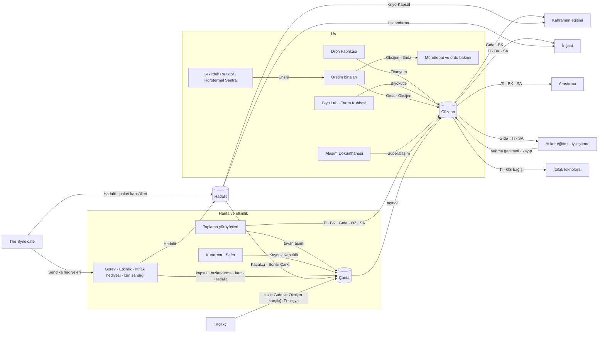

# 15 · Ekonomi Akışı

> **Özet.** Bu bölüm Hadal ekonomisinin muhasebesidir: her kaynağın nereden geldiği, nereye gittiği ve
> ücretsiz oyuncunun (F2P) saatlik gelirinin hangi kaynaklardan oluştuğu. Gelir dökümü aşağıdan
> yukarı kurulur (bina üretimi, toplama, kurtarma, sefer, görev, etkinlik, ittifak, Derinlik İzni
> sandığı) ve toplamı [02 · Tempo ve Denge](02_tempo_ve_denge.md)'nin F2P gelir profiliyle
> karşılaştırılır; üretici bu karşılaştırmayı her çalıştırmada denetler (±%20). Hikâye görevleri 10
> bölüme genişler ve Reaktör 20'ye kadar reaktör maliyetinin bir payını öder; günlük görevler 150 puana
> çıkar (K-09); bütün ödüller **Kaynak Kapsülü** olarak çantaya düşer ve tavanda hiçbir ödül kaybolmaz.
> Ücretsiz oyuncunun genel ve inşaat hızlandırması dökümü ile Hadalit bütçesi de buradadır.

Bağlantılar: [00 · Kanon](00_kanon.md) · [01 · Temel Kavramlar](01_temel_kavramlar.md) ·
[02 · Tempo ve Denge](02_tempo_ve_denge.md) · [07 · Birlikler ve Savaş](07_birlikler_ve_savas.md) ·
[08 · Denizaltılar, Basınç, Seferler](08_denizaltilar_basinc_seferler.md) ·
[09 · Dünya Haritası ve PvP](09_dunya_haritasi_ve_pvp.md) · [10 · İttifak](10_ittifak.md) ·
[11 · VIP](11_vip.md) · [12 · The Syndicate](12_syndicate.md) · [13 · Etkinlikler ve Sezonlar](13_etkinlikler_ve_sezonlar.md) ·
[14 · Son Oyun](14_son_oyun.md) · [16 · Kronik, Köken, Profil](16_kronik_kokenler_profil.md) ·
[Tempo simülasyonu](uretilen/simulasyon.md).

---

## 1. Amaç

1. **Bir yıllık tempoyu taşımak.** F2P oyuncu Reaktör 50'ye
   <!--v:hesap.sim.f2p.gun_50|gun-->368,1. gün<!--/v--> ulaşır. Simülasyon geliri tek bir eğri olarak
   alır; bu bölüm o eğrinin hangi oyun eylemlerinden geldiğini gösterir. Eğri ile döküm ayrışırsa ya
   tempo ya da ödüller yanlıştır.
2. **Her gün yapacak bir şey.** Gelirin yaklaşık yarısı binalardan, kalanı oyuncunun haritada, görev
   ekranında ve ittifakında yaptıklarından gelir. Oturum açmak ödüllendirilir, açmamak cezalandırılmaz
   (12 saatlik çevrimdışı birikim, kapsüller).
3. **Para ile zaman arasında adil bir kur.** Harcayan oyuncu daha hızlı ilerler ama ücretsiz oyuncunun
   kazandığı her şeye o da erişir. Sıralama etkinlikleri Titanyum vermez; böylece sıralama gücü kaynak
   gelirine dönüşüp ekonomiyi şişirmez.

---

## 2. Kurallar

### 2.1 Gelir Saati (GS)

Görev, sandık, etkinlik, kurtarma, sefer ve İzin sandığı ödüllerindeki Titanyum **Gelir Saati** ile yazılır:

```
1 GS = F2P'nin o reaktör seviyesindeki saatlik Titanyum geliri  (f2p_profilleri → titanyum_saat)
Biyokütle = 0,4 × Titanyum  (biyokutle_orani)
```

Reaktör 30'da 1 GS = <!--v:veri.f2p_profilleri.gelir.titanyum_saat.6.1-->90.000<!--/v--> Titanyum ve
36.000 Biyokütledir. Böylece "0,5 GS" bir görev ödülü her seviyede aynı ağırlıktadır: ilk gün de son
ay da yarım saatlik gelirdir. GS'yi kullanan komşu sistemler: kurtarma görevleri ([08](08_denizaltilar_basinc_seferler.md)),
İzin sandığı ([11](11_vip.md)), ittifak bağışı ([10](10_ittifak.md)), paket içerikleri ([12](12_syndicate.md)).

- **Damga.** Kapsülün değeri verildiği anın reaktör seviyesiyle sabitlenir ve üzerinde yazar
  ("Titanyum Kapsülü · 45.000"). Düşük seviyede kapsül biriktirip yüksek seviyede açmak kazanç sağlamaz.
- **Yuvarlama.** Damgalanan miktar üç anlamlı basamağa yuvarlanır (bina maliyetleriyle aynı kural).
- **Süperalaşım ve Hadalit GS'ye bağlı değildir;** sabit miktarlarla verilir.

### 2.2 Kaynak Kapsülü ve tavan

| Kaynak girişi | Nereye gider | Tavan |
|---|---|---|
| Bina üretimi | Cüzdana | Tavanda durur; bina "dolu" görünür |
| Çevrimdışı birikim | Cüzdana | En fazla <!--v:veri.oduller.birim.cevrimdisi_saat-->12<!--/v--> saat (kodda) |
| Toplama yürüyüşü dönüşü | Cüzdana | Tavanı aşan yük **Taşma Kapsülü** olur |
| Görev, sandık, etkinlik, kurtarma, sefer, posta | **Çantaya**, kapsül olarak | Tavana takılmaz |
| Kapsül açma | Cüzdana | Tavanı aşabilir; tavan yalnız pasif üretimi durdurur |

Çanta yağmadan korunur; cüzdandaki korumasız stok saldırıda alınabilir ([09](09_dunya_haritasi_ve_pvp.md)).
Oyuncu kapsülleri ihtiyaç anında açar; "ödül tavanda kayboldu" hissi ortadan kalkar, açıp bekletmek
ise risklidir.

Hedef tavanlar (reaktörle büyür; Basınç Ambarı üstüne ek kapasite ve koruma verir):

<!-- URET:tavanlar -->
| Reaktör | Titanyum | Biyokütle | Gıda | Oksijen | Enerji |
| ---: | ---: | ---: | ---: | ---: | ---: |
| 1 | 25.000 | 6.000 | 5.000 | 6.000 | 10.000 |
| 5 | 25.000 | 6.000 | 5.000 | 6.000 | 10.000 |
| 10 | 25.000 | 6.000 | 5.000 | 6.000 | 10.000 |
| 15 | 60.300 | 24.100 | 24.100 | 20.100 | 16.100 |
| 20 | 246.000 | 98.400 | 98.400 | 82.000 | 65.600 |
| 25 | 764.000 | 305.000 | 305.000 | 254.000 | 204.000 |
| 30 | 1.950.000 | 780.000 | 780.000 | 650.000 | 520.000 |
| 35 | 4.300.000 | 1.720.000 | 1.720.000 | 1.440.000 | 1.150.000 |
| 40 | 8.610.000 | 3.440.000 | 3.440.000 | 2.870.000 | 2.300.000 |
| 45 | 17.200.000 | 6.900.000 | 6.900.000 | 5.750.000 | 4.600.000 |
| 49 | 30.000.000 | 12.000.000 | 12.000.000 | 10.000.000 | 8.000.000 |
<!-- /URET:tavanlar -->

### 2.3 Günlük sıfırlama, haklar ve F2P varsayımları

- Günlük görevler ve etkinlik sandıkları **00:00 UTC**'de sıfırlanır (kodda).
- Sabit günlük haklar oynama süresiyle büyümez: 1 kurtarma kuyruğu, 5 Arena denemesi, haftada 4
  Mahzen ödülü, Lig'de Titanyum veren 2 günlük kademe, kurtarmadan günde en çok 60 Hadalit.
- F2P her gün girer, günlük görevlerin hepsini bitirir (15–20 dakika), toplama yürüyüşleri günde
  <!--v:veri.oduller.birim.toplama_saat-->12<!--/v--> saat çalışır ve yürüyüşlerin
  %<!--v:veri.oduller.birim.toplama_ti_payi-->50<!--/v-->'si Titanyum yataklarına gider (Reaktör 35'ten
  sonra %45, 40'tan sonra %40: yürüyüşler nodül sahasına ve Hadalit Damarı'na kayar); aktif bir ittifaktadır.

---

## 3. Gelir dökümü (F2P, Titanyum/saat)

Aşağıdaki tablo her kaynağı ayrı hesaplar ve toplar; **Profil** sütunu tempo simülasyonunun kullandığı
F2P gelir eğrisidir. Üretici `f2p_gelir_ozeti`'ni profille karşılaştırır ve %20'den büyük sapmada hata verir.

<!-- URET:tablo:oduller.gelir_dokumu -->
| Reaktör | F2P günü | Binalar | Toplama | Kurtarma | Sefer | Görev | Etkinlik + ittifak | İzin sandığı | **Toplam Ti/sa** | Profil Ti/sa | Sapma |
| ---: | ---: | ---: | ---: | ---: | ---: | ---: | ---: | ---: | ---: | ---: | ---: |
| 10 | 7 sa 12 dk | 3.780 | 2.700 | 530 | 620 | 550 | 570 | 0 | 8.740 | 9.000 | −%2,9 |
| 15 | 1,4. gün | 7.440 | 5.600 | 2.500 | 1.380 | 1.220 | 1.260 | 0 | 19.400 | 20.000 | −%3 |
| 20 | 4,5. gün | 14.650 | 8.400 | 4.750 | 1.580 | 3.260 | 4.460 | 790 | 37.890 | 38.000 | −%0,3 |
| 25 | 13,4. gün | 22.500 | 14.180 | 7.750 | 2.580 | 5.320 | 4.690 | 2.580 | 59.600 | 62.000 | −%3,9 |
| 30 | 28,6. gün | 34.560 | 18.900 | 10.500 | 3.750 | 7.720 | 6.800 | 3.750 | 85.990 | 90.000 | −%4,5 |
| 35 | 68,7. gün | 51.150 | 24.840 | 14.580 | 5.210 | 10.730 | 9.450 | 7.810 | 123.770 | 125.000 | −%1 |
| 40 | 128,4. gün | 75.700 | 29.760 | 19.830 | 7.080 | 14.590 | 12.850 | 14.170 | 173.990 | 170.000 | %2,3 |
| 45 | 224,9. gün | 102.100 | 38.240 | 26.830 | 9.580 | 19.740 | 17.390 | 19.170 | 233.050 | 230.000 | %1,3 |
| 50 | 368,1. gün | 137.700 | 48.960 | 35.000 | 12.500 | 25.750 | 22.680 | 25.000 | 307.590 | 300.000 | %2,5 |
<!-- /URET:tablo:oduller.gelir_dokumu -->

Paylar (son sütun: bina / harita (toplama + kurtarma + sefer) / görev, etkinlik ve İzin):

<!-- URET:tablo:oduller.gelir_paylari -->
| Reaktör | Binalar | Toplama | Kurtarma | Sefer | Görev | Etkinlik + ittifak | İzin sandığı | Bina / harita / görev-etkinlik-İzin |
| ---: | ---: | ---: | ---: | ---: | ---: | ---: | ---: | --- |
| 10 | %43,3 | %30,9 | %6 | %7,1 | %6,3 | %6,5 | %0 | 43 / 44 / 13 |
| 15 | %38,4 | %28,9 | %12,9 | %7,1 | %6,3 | %6,5 | %0 | 38 / 49 / 13 |
| 20 | %38,7 | %22,2 | %12,5 | %4,2 | %8,6 | %11,8 | %2,1 | 39 / 39 / 22 |
| 25 | %37,7 | %23,8 | %13 | %4,3 | %8,9 | %7,9 | %4,3 | 38 / 41 / 21 |
| 30 | %40,2 | %22 | %12,2 | %4,4 | %9 | %7,9 | %4,4 | 40 / 39 / 21 |
| 35 | %41,3 | %20,1 | %11,8 | %4,2 | %8,7 | %7,6 | %6,3 | 41 / 36 / 23 |
| 40 | %43,5 | %17,1 | %11,4 | %4,1 | %8,4 | %7,4 | %8,1 | 44 / 33 / 24 |
| 45 | %43,8 | %16,4 | %11,5 | %4,1 | %8,5 | %7,5 | %8,2 | 44 / 32 / 24 |
| 50 | %44,8 | %15,9 | %11,4 | %4,1 | %8,4 | %7,4 | %8,1 | 45 / 31 / 24 |
<!-- /URET:tablo:oduller.gelir_paylari -->

Okuma notları:

- İlk günlerde (R10–R15) harita ve kurtarma ağırlıklıdır: binalar henüz küçüktür, İlk Dalış Haftası
  sürer. Reaktör 35'ten sonra pay profilin hedeflediği **~%45 bina / ~%35 harita / ~%20 görev ve
  etkinlik** dengesine yaklaşır; İzin sandığı görev payını birkaç puan büyütür.
- Bütün bantlarda sapma ±%5'in içindedir. Hikâye görevleri bu tablonun **dışındadır**: simülasyon
  onları reaktör seviyesine ulaşıldığında toplu ödeme olarak ekler (§4.1).

### 3.1 Binalar

Titanyumu Dron Fabrikası üretir (3 örnek; R2, R4, R7'de açılır). Ham üretim
[Dron Fabrikası](binalar/drone_factory.md) tablosundandır; **verim çarpanı** araştırma, mürettebat,
ittifak teknolojisi, İzin ve Takviye bonuslarının toplamıdır.

<!-- URET:tablo:oduller.bina_uretimi -->
| Reaktör | Dron Fabrikası | Seviye | Ham Ti/sa (toplam) | Verim çarpanı | Net Ti/sa |
| ---: | ---: | ---: | ---: | ---: | ---: |
| 10 | 3 | 10 | 2.700 | 1,4 | 3.780 |
| 15 | 3 | 15 | 5.052 | 1,47 | 7.440 |
| 20 | 3 | 20 | 9.450 | 1,55 | 14.650 |
| 25 | 3 | 25 | 14.286 | 1,57 | 22.500 |
| 30 | 3 | 30 | 21.600 | 1,6 | 34.560 |
| 35 | 3 | 35 | 31.488 | 1,62 | 51.150 |
| 40 | 3 | 40 | 45.900 | 1,65 | 75.700 |
| 45 | 3 | 45 | 60.975 | 1,67 | 102.100 |
| 50 | 3 | 50 | 81.000 | 1,7 | 137.700 |
<!-- /URET:tablo:oduller.bina_uretimi -->

Verim çarpanının bileşenleri (hedef; sayıların sahibi parantezdeki bölümdür). Araştırma satırı
ücretsiz oyuncunun iki Titanyum teknolojisindeki tipik seviyesidir (tavan: Reaktör 20 civarında %40,
Reaktör 47'den sonra %60); İzin satırı 11'in üretim ayrıcalığıdır:

<!-- URET:tablo:oduller.carpan_bilesenleri -->
| Bileşen | R10 | R20 | R30 | R50 |
| --- | ---: | ---: | ---: | ---: |
| Araştırma: Titanyum Geri Kazanımı + Kobalt Kabuğu Kazıma (06) | %12 | %24 | %32 | %44 |
| Mürettebat ataması (Yatakhane) | %10 | %12 | %12 | %10 |
| İttifak teknolojisi (10) | %5 | %8 | %8 | %8 |
| Derinlik İzni üretimi (11) | %0 | %1 | %4 | %8 |
| Takviye ortalaması | %13 | %10 | %4 | %0 |
| **Toplam (çarpan − 1)** | %40 | %55 | %60 | %70 |
<!-- /URET:tablo:oduller.carpan_bilesenleri -->

### 3.2 Toplama

Her Denizaltı Hangarı bir yürüyüş kuyruğudur (R4, R10, R18, R26'da açılır, en çok 4). Yürüyüş başına
hız, oyuncunun o bantta topladığı tipik yatağın **etkin** hızıdır ([09](09_dunya_haritasi_ve_pvp.md),
`harita.json` → `dugum_seviyeleri`); yatak seviyesi, F2P'nin o reaktöre ulaştığı günde Kronik'in kesin
açtığı seviyeyle sınırlanır. Yürüyüş yükü [07](07_birlikler_ve_savas.md)'dedir.

<!-- URET:tablo:oduller.toplama -->
| Reaktör | F2P günü | Yürüyüş (hangar) | Tipik yatak Sv | Yürüyüş başına Ti/sa (09 'etkin') | Günlük toplama saati | Titanyuma giden pay | Ti/gün | Ortalama Ti/sa |
| ---: | ---: | ---: | ---: | ---: | ---: | ---: | ---: | ---: |
| 10 | 7 sa 12 dk | 2 | 2 | 5.400 | 12 | %50 | 64.800 | 2.700 |
| 15 | 1,4. gün | 2 | 3 | 11.200 | 12 | %50 | 134.400 | 5.600 |
| 20 | 4,5. gün | 3 | 3 | 11.200 | 12 | %50 | 201.600 | 8.400 |
| 25 | 13,4. gün | 3 | 4 | 18.900 | 12 | %50 | 340.200 | 14.180 |
| 30 | 28,6. gün | 4 | 4 | 18.900 | 12 | %50 | 453.600 | 18.900 |
| 35 | 68,7. gün | 4 | 5 | 27.600 | 12 | %45 | 596.200 | 24.840 |
| 40 | 128,4. gün | 4 | 6 | 37.200 | 12 | %40 | 714.200 | 29.760 |
| 45 | 224,9. gün | 4 | 7 | 47.800 | 12 | %40 | 917.800 | 38.240 |
| 50 | 368,1. gün | 4 | 8 | 61.200 | 12 | %40 | 1.175.000 | 48.960 |
<!-- /URET:tablo:oduller.toplama -->

### 3.3 Kurtarma görevleri

Dron Fabrikası'nın kurtarma kuyruğu (kodda var). Görevler ve ödülleri [08](08_denizaltilar_basinc_seferler.md)'indir;
ödül "saat" sütunu doğrudan GS'dir:

<!-- URET:tablo:denizaltilar.kurtarma_hedef -->
| Görev | Süre | Açılış | Titanyum (GS) | R10 Ti | R20 Ti | R30 Ti | R40 Ti | R50 Ti | Hadalit (×10) |
| --- | ---: | --- | ---: | ---: | ---: | ---: | ---: | ---: | --- |
| Hızlı | 15 dk | Dron Fabrikası 1 | 0,1 | 900 | 3.800 | 9.000 | 17.000 | 30.000 | — |
| Standart | 1 sa | Dron Fabrikası 1 | 0,3 | 2.700 | 11.400 | 27.000 | 51.000 | 90.000 | %25 şansla 20–40 |
| Derin | 4 sa | Dron Fabrikası 1 | 0,8 | 7.200 | 30.400 | 72.000 | 136.000 | 240.000 | %60 şansla 40–80 |
| Gece Kurtarması | 8 sa | Reaktör 15 | 1,4 | — | 53.200 | 126.000 | 238.000 | 420.000 | %70 şansla 60–120 |
| Çukur Kurtarması | 12 sa | Reaktör 30 | 2 | — | — | 180.000 | 340.000 | 600.000 | %80 şansla 80–160; %20 şansla 10–30 SA |
<!-- /URET:tablo:denizaltilar.kurtarma_hedef -->

F2P'nin günlük düzeni (tek kuyruk; gece ve iş saatlerinde uzun görev):

<!-- URET:tablo:oduller.kurtarma -->
| Reaktör | F2P'nin günlük düzeni (08 görevleri) | GS/gün | Ti/gün | Beklenen Hadalit/gün | Günlük 60 sınırıyla | Ortalama Ti/sa |
| ---: | --- | ---: | ---: | ---: | ---: | ---: |
| 10 | 3 × Hızlı + 1 × Standart + 1 × Derin | 1,4 | 12.600 | 44 | 44 | 530 |
| 15 | 2 × Derin + 1 × Gece Kurtarması | 3 | 60.000 | 135 | 60 | 2.500 |
| 20 | 2 × Derin + 1 × Gece Kurtarması | 3 | 114.000 | 135 | 60 | 4.750 |
| 25 | 2 × Derin + 1 × Gece Kurtarması | 3 | 186.000 | 135 | 60 | 7.750 |
| 30 | 1 × Derin + 1 × Çukur Kurtarması | 2,8 | 252.000 | 132 | 60 | 10.500 |
| 35 | 1 × Derin + 1 × Çukur Kurtarması | 2,8 | 350.000 | 132 | 60 | 14.580 |
| 40 | 1 × Derin + 1 × Çukur Kurtarması | 2,8 | 476.000 | 132 | 60 | 19.830 |
| 45 | 1 × Derin + 1 × Çukur Kurtarması | 2,8 | 644.000 | 132 | 60 | 26.830 |
| 50 | 1 × Derin + 1 × Çukur Kurtarması | 2,8 | 840.000 | 132 | 60 | 35.000 |
<!-- /URET:tablo:oduller.kurtarma -->

### 3.4 Sefer

Denizaltı seferleri, enkaz kurtarma ve buluntular ([08](08_denizaltilar_basinc_seferler.md)): erken
oyunda (kampanya bölümleri 1–4, dış kuşakların bol enkazı) günde
<!--v:veri.oduller.birim.sefer_gs_gun_erken-->1,65<!--/v--> GS, Reaktör 20'den sonra
<!--v:veri.oduller.birim.sefer_gs_gun_gec-->1<!--/v--> GS. Kampanyanın ilk geçiş ödülleri bu payın bir
parçasıdır; geri kalanı enkaz dalışları ve haftalık Derin Tekrar'dır. P7+ seferler Süperalaşım da verir.

<!-- URET:tablo:oduller.sefer -->
| Reaktör | GS/gün | Ti/gün | BK/gün | Ortalama Ti/sa |
| ---: | ---: | ---: | ---: | ---: |
| 10 | 1,65 | 14.800 | 5.940 | 620 |
| 15 | 1,65 | 33.000 | 13.200 | 1.380 |
| 20 | 1 | 38.000 | 15.200 | 1.580 |
| 25 | 1 | 62.000 | 24.800 | 2.580 |
| 30 | 1 | 90.000 | 36.000 | 3.750 |
| 35 | 1 | 125.000 | 50.000 | 5.210 |
| 40 | 1 | 170.000 | 68.000 | 7.080 |
| 45 | 1 | 230.000 | 92.000 | 9.580 |
| 50 | 1 | 300.000 | 120.000 | 12.500 |
<!-- /URET:tablo:oduller.sefer -->

### 3.5 Etkinlik ve ittifak

Etkinliklerin F2P'ye haftalık Titanyum katkısı. Rekabetçi etkinlikler (Konvoy, Egemen Yarışı, Arena,
Akıntı Savaşı) bilerek sıfırdır: onlar para birimi, kart, hızlandırma ve kozmetik verir.

<!-- URET:tablo:oduller.etkinlik_geliri -->
| Kaynak | Açılış | GS/hafta | GS/gün | R30'da Ti/hafta |
| --- | --- | ---: | ---: | ---: |
| İlk Dalış Haftası (yeni kaptan, 7 gün) | R1, ilk 7 gün | 7 | 1 | 630.000 |
| Derinlik Ligi (günlük kademe I–II) | R16 | 5,1 | 0,73 | 459.000 |
| Sürü Baskını (dalga ödülleri, 2 pencere) | R16 | 1,5 | 0,21 | 135.000 |
| Leviathan Avı (dalga ödülleri) | R18 + ittifak | 1,3 | 0,19 | 117.000 |
| Muhafız Mahzeni (4 ödül hakkı) | R20 | 1,2 | 0,17 | 108.000 |
| Doğa olayları (geçici yataklar) | R10 | 1 | 0,14 | 90.000 |
| Derinlik Kroniği hedefleri (16) | Kronik Feneri (R8) | 0,5 | 0,07 | 45.000 |
| İttifak hediyeleri (10) | İttifak | 2,1 | 0,3 | 189.000 |
| Konvoy, Egemen Yarışı, Arena, Akıntı Savaşı | R16–Kronik 7 | 0 | 0 | 0 |
<!-- /URET:tablo:oduller.etkinlik_geliri -->

İttifak hediyeleri (mekaniği [10](10_ittifak.md), paket eşlemesi [12](12_syndicate.md)'tedir; burada
yalnız ekonomik payı):

<!-- URET:tablo:oduller.ittifak_hediyeleri -->
| Hediye (sahibi) | Ne zaman | F2P günlük ortalaması |
| --- | --- | --- |
| Kıyı, Derin ve Hadal Hediyesi (10, 12) | Bir üye The Syndicate'ten alım yaptığında tüm üyelere | Titanyum 0,15 GS · 8 dk genel hızlandırma · 10 HD |
| Av Hediyesi (10) | İttifak bir Demir Leviathan yuvasını yendiğinde | Titanyum 0,05 GS · 3 dk hızlandırma |
| Kronik Hediyesi ve Derin Hazine (10) | İttifak Kronik hedefi; hediye puanı çubuğu her 2.000 puanda | Titanyum 0,05 GS · 2 dk hızlandırma |
| Av Sandığı (13 · Leviathan Avı) | Haftalık avda 5., 10. ve 15. dalga temizlenince | Titanyum 0,05 GS · 2 dk hızlandırma |
| **Toplam** | Aktif bir ittifakta | **Titanyum 0,3 GS · 15 dk hızlandırma** (hizlandiricilar.json ile aynı) |
<!-- /URET:tablo:oduller.ittifak_hediyeleri -->

### 3.6 Derinlik İzni sandığı

İzin sandığı ([11](11_vip.md)) her gün GS cinsinden bir kaynak kapsülü verir; F2P'nin İzin seviyesi
11'in puan modelinden okunur:

<!-- URET:tablo:oduller.izin_sandigi -->
| Reaktör | F2P günü | F2P İzin seviyesi | Sandıktaki gelir saati | Ti/gün |
| ---: | ---: | ---: | ---: | ---: |
| 10 | 7 sa 12 dk | 0 | 0 | 0 |
| 15 | 1,4. gün | 0 | 0 | 0 |
| 20 | 4,5. gün | 1 | 0,5 | 19.000 |
| 25 | 13,4. gün | 3 | 1 | 62.000 |
| 30 | 28,6. gün | 4 | 1 | 90.000 |
| 35 | 68,7. gün | 5 | 1,5 | 188.000 |
| 40 | 128,4. gün | 6 | 2 | 340.000 |
| 45 | 224,9. gün | 6 | 2 | 460.000 |
| 50 | 368,1. gün | 7 | 2 | 600.000 |
<!-- /URET:tablo:oduller.izin_sandigi -->

---

## 4. Görevler

### 4.1 Hikâye bölümleri (Reaktör 2–20)

Bugünkü 20 hikâye görevi Reaktör 8'de biter. Hedefte hikâye **10 bölüm** olur ve Reaktör 20'de
kapanır. Kural:

```
bölümün Titanyum ve Biyokütle toplamı = Σ (görev_odulu_payi(L) × reaktör L maliyeti),  L bölümün reaktör aralığı
görev_odulu_payi: R2 %80 → R12 %60 → R20 %25 → R21+ %0   (f2p_profilleri)
```

Toplam, bölümün görevlerine dağıtılır; en büyük pay bölümün son görevi olan "Çekirdek Reaktör L"
görevindedir. Hikâye boyunca toplam
<!--v:veri.oduller.birim.hikaye_ti_toplam-->168.000<!--/v--> Titanyum,
<!--v:veri.oduller.birim.hikaye_bk_toplam-->58.600<!--/v--> Biyokütle ve
<!--v:veri.oduller.birim.hikaye_hd_toplam-->6.900<!--/v--> Hadalit verilir.

<!-- URET:tablo:oduller.hikaye_bolumleri -->
| Bölüm | Ad | Reaktör | Görev | Titanyum | Biyokütle | Reaktör maliyetinin karşılanan payı | Hadalit | Genel hızlandırma (dk) | Özel ödül |
| ---: | --- | --- | ---: | ---: | ---: | ---: | ---: | ---: | --- |
| 1 | Son Konvoy | 2–3 | 6 | 220 | 0 | %79 | 300 | 0 | Lyra Moss ×10 kart (çağırmaya yeter) |
| 2 | Enkaz Tarlası | 4–5 | 7 | 780 | 270 | %74 | 300 | 10 | Tess Ruiz ×10 kart, Bronz Sandık ×2 |
| 3 | Kriyo Salonundaki Uyuyanlar | 6–8 | 8 | 3.340 | 1.170 | %69 | 500 | 20 | Nadir kart ×2, Altın Sandık |
| 4 | Fenerin Işığı | 9–10 | 7 | 5.380 | 1.880 | %64 | 500 | 20 | Efsanevi kart ×1 (bugünkü R8 ödülü buraya kayar) |
| 5 | Soğuk Sızıntı | 11–12 | 8 | 10.500 | 3.690 | %61 | 600 | 30 | Destansı kart ×1, Gümüş Sandık ×2 |
| 6 | Kadim İz | 13–14 | 8 | 18.000 | 6.300 | %51 | 600 | 30 | Destansı kart ×1, teçhizat malzemesi |
| 7 | Savaş Kubbesi | 15–16 | 8 | 28.500 | 10.000 | %41 | 800 | 30 | Altın Sandık, 50 Kubbe Nişanı |
| 8 | Sürü | 17–18 | 8 | 41.200 | 14.400 | %33 | 800 | 30 | Destansı kart ×1, orta Sonar Pili ×2 |
| 9 | Demir Gövde | 19 | 6 | 27.100 | 9.460 | %28 | 1.000 | 30 | Efsanevi kart ×1 |
| 10 | Kapıdaki Ses | 20 | 6 | 32.500 | 11.400 | %25 | 1.500 | 30 | Altın Sandık ×2, 'Kapıdaki Ses' profil çerçevesi |
<!-- /URET:tablo:oduller.hikaye_bolumleri -->

<!-- URET:tablo:oduller.hikaye_temalari -->
| Bölüm | Ad | Konu |
| ---: | --- | --- |
| 1 | Son Konvoy | İniş: ilk ışıklar, Oksijen ve Gıda; Komutan Elias Rourke üssü kurar. |
| 2 | Enkaz Tarlası | Dron Fabrikası, ilk kurtarma, Biyo Laboratuvar; Tess Ruiz ×10 kart. |
| 3 | Kriyo Salonundaki Uyuyanlar | Kriyo Salonu, ilk çekiliş, ittifaka katılma, Kalkan Jeneratörü. |
| 4 | Fenerin Işığı | Kronik Feneri kurulur; sunucunun ortak hikâyesi görünür olur. |
| 5 | Soğuk Sızıntı | Bilim Kubbesi, ikinci laboratuvar ve üçüncü tezgâh; ilk soğuk sızıntı taraması. |
| 6 | Kadim İz | Teçhizat Atölyesi ve anıtlar; bir enkazda ilk kadim yazıt. |
| 7 | Savaş Kubbesi | Kalıntı Arşivi ve Savaş Kubbesi; Basınç Arenası ve Derinlik Ligi açılır. |
| 8 | Sürü | Uçurum Sürüngenleri üssü yoklar; ilk Sürü Baskını; ikinci hangar. |
| 9 | Demir Gövde | Sonarda bir Demir Leviathan'ın yankısı; Leviathan Avı'na hazırlık. |
| 10 | Kapıdaki Ses | Çukurun dibinden düzenli bir titreşim: Kronik'in İlk Yankı'sı. |
<!-- /URET:tablo:oduller.hikaye_temalari -->

Örnek: Bölüm 5'in görevleri (görev türleri bugünkü koddakilerle aynıdır; `scan`, `dive` ve
`research_parallel` yeni sayaçlardır):

<!-- URET:tablo:oduller.ornek_bolum -->
| Kimlik | Görev | Tür · hedef | Ödül |
| --- | --- | --- | --- |
| q5_dome | Bilim Kubbesi'ni kur | count · science_dome | Bölüm Titanyumunun %10'u + 60 HD |
| q5_queue2 | İki araştırmayı aynı anda yürüt | counter · research_parallel | 30 dk araştırma hızlandırma |
| q5_seep | Radar Merkezi ile bir soğuk sızıntıyı tara | counter · scan | Tür Kataloğu kaydı + 60 HD |
| q5_dive3 | 3 sefer dalışı tamamla | counter · dive | Küçük Sonar Pili ×2 |
| q5_hero20 | Bir kahramanı 20. seviyeye çıkar | heroLevel · 20 | Destansı kart ×1 |
| q5_oxy11 | Oksijen Tesisi'ni 11'e çıkar | level · oxygen_plant | Bölüm Titanyumunun %15'i |
| q5_help10 | 10 ittifak yardımı yap | counter · help | Gümüş Sandık + 15 dk genel hızlandırma |
| q5_reactor12 | Çekirdek Reaktör'ü 12'ye çıkar | level · core_reactor | Bölüm sandığı: kalan Titanyum + Biyokütle + 300 HD + Gümüş Sandık + 15 dk genel |
<!-- /URET:tablo:oduller.ornek_bolum -->

Reaktör 20'den sonra hikâye, sunucunun ortak zaman çizelgesi **Derinlik Kroniği** ile sürer
([16](16_kronik_kokenler_profil.md)); Kronik hedefleri reaktör maliyeti ödemez, ödülleri etkinlik
gelirine dahildir. Bölüm 10'un sonundaki titreşim, Kronik'in İlk Yankı aşamasıyla aynı gündür ve son
oyunun ilk perdesidir ([14](14_son_oyun.md)).

### 4.2 Günlük görevler (150 puan)

Bugünkü 8 görev 130 puan verir; K-09 gereği **dalış** ve **arena** görevleri eklenir ve toplam 150 olur.
Arena Reaktör 16'da (Savaş Kubbesi) açıldığından 150 puan ve onun sandığı fiilen Reaktör 16'dan
itibaren alınır.

<!-- URET:tablo:oduller.gunluk_gorevler -->
| Kimlik | Görev | Puan | Ödül | Açılış | Durum |
| --- | --- | ---: | --- | --- | --- |
| d_upgrade | 2 yükseltme başlat | 20 | Titanyum Kapsülü 0,1 GS | R1 | kodda |
| d_research | 1 araştırma başlat | 20 | Titanyum Kapsülü 0,05 GS + Biyokütle | R3 | kodda |
| d_salvage | 2 kurtarma görevi gönder | 20 | Titanyum Kapsülü 0,05 GS | R2 | kodda |
| d_boost | 1 Takviye kullan | 10 | Titanyum Kapsülü 0,05 GS | R1 | kodda |
| d_help | 3 ittifak yardımı yap | 20 | Titanyum Kapsülü 0,05 GS | İttifak | kodda |
| d_train | 2 kez kahraman eğit | 20 | Gıda Kapsülü + Titanyum 0,05 GS | R2 | kodda |
| d_pod | 1 Kriyo-Kapsül çekimi (ücretsiz sayılır) | 10 | 5 sıradan kart parçası | R2 | kodda |
| d_chat | Sohbete 1 mesaj yaz | 10 | — | R1 | kodda |
| d_dive | 1 sefer dalışı tamamla | 10 | Titanyum Kapsülü 0,05 GS + küçük Sonar Pili | R4 | tasarim |
| d_arena | 1 Basınç Arenası maçı yap | 10 | 20 Kubbe Nişanı | R16 | tasarim |
<!-- /URET:tablo:oduller.gunluk_gorevler -->

### 4.3 Etkinlik sandıkları

Eşikler bugünküyle aynıdır (20 / 40 / 60 / 80 / 100); 150 puana **Derinlik Sandığı** eklenir. 100 puan
sandığı 10 İzin puanı da verir ([11](11_vip.md)). Görevlerin ve sandıkların F2P'ye Titanyum katkısı:
R16 öncesi <!--v:veri.oduller.birim.gorev_gs_gun_once-->1,46<!--/v--> GS/gün, sonrası
<!--v:veri.oduller.birim.gorev_gs_gun_sonra-->2,06<!--/v--> GS/gün.

<!-- URET:tablo:oduller.etkinlik_sandiklari -->
| Puan | Sandık | İçerik | Beklenen Ti (GS) | Hızlandırma | Beklenen Hadalit | Bugün |
| ---: | --- | --- | ---: | --- | ---: | --- |
| 20 | Titanyum Kapsülü | Titanyum 0,25 GS | 0,25 | — | 0 | kodda (1.000 Ti sabit) |
| 40 | Bronz Sandık | 2 çekiliş (Ti 0,3 GS %35 · BK %25 · Gıda %20 · 5 sıradan parça %15 · 100 HD %5) | 0,21 | 5 dk inşaat + 10 dk araştırma | 10 | kodda (hızlandırmasız) |
| 60 | Sıradan Kahraman Kartı | 10 sıradan kart + Biyokütle Kapsülü 0,25 GS | 0 | — | 0 | kodda (kapsülsüz) |
| 80 | Gümüş Sandık | Ti 0,3 GS + 2 çekiliş (Ti 0,5 GS %30 · BK %25 · sıradan ×10 %20 · nadir ×5 %20 · 200 HD %5) | 0,6 | 5 dk genel + 5 dk araştırma + 10 dk eğitim | 20 | kodda (hızlandırmasız) |
| 100 | Nadir Kahraman Kartı | 10 nadir kart + 200 Hadalit + 10 İzin puanı | 0 | 10 dk genel | 200 | kodda (20 HD; K-12 ile ×10) |
| 150 | Derinlik Sandığı | Ti 0,6 GS + küçük Sonar Pili + 1 çekiliş (50 HD %20 · destansı parça ×5 %40 · teçhizat malzemesi %40; R30+ Süperalaşım 10) | 0,6 | — | 10 | tasarim |
<!-- /URET:tablo:oduller.etkinlik_sandiklari -->

---

## 5. Süperalaşım

Süperalaşım Reaktör 30'dan sonra kapı kaynağıdır (K-01). Gelir, oyuncunun Reaktör 30'a ulaştığı
günden itibaren sayılır. Dökümhane üretimi [Alaşım Dökümhanesi](binalar/alloy_foundry.md)
tablosundandır (R30 ve R40'ta birer örnek); geri kalanı nodül sahası toplaması (1 yürüyüş, günde ~10 sa;
[09](09_dunya_haritasi_ve_pvp.md)), P7+ seferler ve Çukur Kurtarması, etkinlikler (Mahzen III+, Sürü,
Titan, Leviathan yuvaları) ve sezon dükkânıdır.

<!-- URET:tablo:oduller.alasim_dokumu -->
| R30'dan sonra gün | Oyun günü | Reaktör (F2P) | Dökümhane | Dökümhane SA/gün | Nodül sahası | Sefer + kurtarma | Etkinlik + sezon | **Toplam SA/gün** | Profil | Sapma |
| ---: | ---: | ---: | ---: | ---: | ---: | ---: | ---: | ---: | ---: | ---: |
| 0 | 28,6. gün | 30 | 1 | 12 | 16 | 6 | 6 | 40 | 40 | %0 |
| 30 | 58,6. gün | 34 | 1 | 16 | 21 | 9 | 10 | 55 | 52 | %5,1 |
| 90 | 118,6. gün | 39,3 | 1 | 27 | 29 | 13 | 15 | 84 | 90 | −%6,2 |
| 180 | 208,6. gün | 44,2 | 2 | 79 | 32 | 16 | 18 | 144 | 140 | %3 |
| 270 | 298,6. gün | 47,7 | 2 | 97 | 41 | 21 | 24 | 183 | 181 | %1 |
| 337 | 365,6. gün | 49,9 | 2 | 112 | 50 | 26 | 32 | 219 | 220 | −%0,4 |
<!-- /URET:tablo:oduller.alasim_dokumu -->

Süperalaşım yağmalanmaz ve takas edilmez; Hadalitle tamamlanamaz ([12](12_syndicate.md)). Reaktör 31–40
arasındaki bekleme (<!--v:hesap.sim.f2p.toplam.bekleme_alasim|gun-->21,2. gün<!--/v--> toplam) bilinçli
bir darboğazdır: ikinci dökümhane Reaktör 40'ta gelir ve sonrasında üretim ikiye katlanır.

---

## 6. Hadalit

Hadalit ×10 ölçeklenir ve tavansızdır (K-12): Kriyo-Kapsül çekimi 200, onluk 1.800. Bugünkü kodun
ödülleri (günlük 100 puan sandığı 20 → 200, kurtarma 2–8 → 20–80, sandıklar) aynı oranla çarpılır;
yeni kaynaklar bilerek küçük tutulur.

| Dönem | Günlük (İzin hariç) | Aylık | Kriyo-Kapsül karşılığı |
|---|---:|---:|---:|
| R1–R15 (ilk 2 gün) | <!--v:veri.oduller.birim.hadalit_erken-->303<!--/v--> | — | ~1,5 çekim/gün |
| R16–R29 | <!--v:veri.oduller.birim.hadalit_orta-->354<!--/v--> | <!--v:veri.oduller.birim.hadalit_ay_orta-->10.620<!--/v--> | ~53 çekim/ay |
| R30+ (180. güne kadar) | <!--v:veri.oduller.birim.hadalit_gec-->374<!--/v--> | <!--v:veri.oduller.birim.hadalit_ay_gec-->11.220<!--/v--> | ~56 çekim/ay |
| 180. günden sonra | <!--v:veri.oduller.birim.hadalit_son-->389<!--/v--> | — | ~1,9 çekim/gün |

Hikâye bölümleri ilk 4,5 günde ayrıca 6.900 Hadalit verir. İzin sandığı ([11](11_vip.md)) ayrı tutulur
ve ayda ~450–1.500 Hadalit ekler.

<!-- URET:tablo:oduller.hadalit -->
| Kaynak | Açılış | R1–R15 | R16–R29 | R30+ (180. güne kadar) | 180. günden sonra | Not |
| --- | --- | ---: | ---: | ---: | ---: | --- |
| Günlük sandık (100 puan) | R1 | 200 | 200 | 200 | 200 | Bugün 20; K-12 ile ×10 |
| Derinlik Sandığı çekilişi (150 puan) | R16 | 0 | 10 | 10 | 10 | %20 × 50 HD |
| Bronz ve Gümüş Sandık çekilişleri | R1 | 30 | 30 | 30 | 30 | Bronz %5 × 100, Gümüş %5 × 200; 2'şer çekiliş |
| Kurtarma görevleri (08) | R2 | 44 | 60 | 60 | 60 | Günlük 60 sınırıyla (kurtarma tablosu) |
| Basınç Arenası günlük sıralaması | R16 | 0 | 15 | 15 | 15 | Orta ve alt sıralar (201–1.000: 25; 1.001+: 15) |
| Etkinlikler (Lig, Sürü, Av, Mahzen, Sınav, olaylar) | R10 | 15 | 25 | 30 | 30 | Haftalık ortalamanın günlüğü |
| Kronik ve Tür Kataloğu başarımları (16) | R8 | 14 | 14 | 14 | 14 | Yılda ~5.000 |
| Akıntı Savaşı (sezon ödülü ve dükkânı) | Kronik 7 | 0 | 0 | 15 | 15 | 60 günlük döngünün günlük ortalaması |
| Hadalit Damarı (09) | Kronik 10 | 0 | 0 | 0 | 15 | Kaptan başına günde en çok 60; sunucuda 12 damar, çekişmeli |
| **Toplam (İzin sandığı hariç)** |  | 303 | 354 | 374 | 389 | ≈ günde 1,5 · 1,8 · 1,9 · 1,9 Kriyo-Kapsül çekimi |
| Derinlik İzni sandığı (11, ayrı tutulur) | İzin 1 | 0 | 15 | 30 | 50 | F2P'nin o dönemdeki İzin seviyesi |
<!-- /URET:tablo:oduller.hadalit -->

**Sendika Sözleşmesi ile karşılaştırma.** F2P'nin aylık Hadalit'i Sözleşme'nin aylık 3.300 Hadalit'inin
~3 katıdır ([12](12_syndicate.md)). Bu oran tür için olağandır: aylık kartın değeri Hadalit'ten çok
3. inşaatçıdan (K-07), hız yüzdesinden, günlük hızlandırmadan ve Süperalaşım payından gelir. F2P
Hadalit'inin üçte ikisi K-12'nin doğrudan ×10'undan (günlük sandık, kurtarma, sandık çekilişleri) gelir;
daha aşağı inmek K-12'nin günlük sandık için değiştirilmesini gerektirir (Açık sorular).

---

## 7. Hızlandırma

Simülasyon F2P'nin günde **0,5 saatten (erken) 2 saate (Reaktör 16+)** kadar inşaata harcanabilir
hızlandırma kazandığını varsayar. **Genel + inşaat** dökümünün sahibi bu bölümdür; [12](12_syndicate.md)
aynı tabloyu gösterir. Araştırma, eğitim ve iyileştirme hızlandırmaları ayrı gelir ve kendi kuyruklarına
gider (`hizlandiricilar.json` → `f2p_tipli`); İzin 1–7 sandığı da araştırma hızlandırması verdiği için
bu tabloda yoktur ([11](11_vip.md)).

<!-- URET:tablo:oduller.hizlandirma -->
| Bant | Günlük sandıklar | Hikâye | İlk Dalış Haftası | Etkinlik + Kronik | Akıntı Savaşı | İttifak | Bilet (ücretsiz yol) | Kurtarma ve sefer | **Toplam sa/gün** | Simülasyon | Sapma |
| --- | ---: | ---: | ---: | ---: | ---: | ---: | ---: | ---: | ---: | ---: | ---: |
| R1–R5 | 0,33 | 0,25 | 0 | 0 | 0 | 0 | 0 | 0 | 0,58 | 0,61 | −%4,9 |
| R6–R10 | 0,33 | 0,33 | 0 | 0 | 0 | 0,08 | 0 | 0,04 | 0,78 | 0,78 | %0 |
| R11–R15 | 0,33 | 0,33 | 0,17 | 0 | 0 | 0,1 | 0 | 0,07 | 1 | 1 | %0 |
| R16–R50 | 0,33 | 0 | 0 | 0,75 | 0,25 | 0,25 | 0,17 | 0,25 | 2 | 2 | %0 |
<!-- /URET:tablo:oduller.hizlandirma -->

R16+ satırının kaynakları: günlük sandıklar 20 dk (40, 80, 100 puan), etkinlikler ve Kronik 45 dk
(Lig kademeleri ve haftalık sıra, Sürü, Konvoy, Egemen K1, Titan; [13](13_etkinlikler_ve_sezonlar.md)),
Akıntı Savaşı 15 dk (sezon ödülü ve dükkânın günlük ortalaması), ittifak 15 dk ([10](10_ittifak.md)),
biletin ücretsiz yolu 10 dk ([12](12_syndicate.md)), kurtarma ve sefer sandıkları 15 dk.
Hızlandırma eşyalarının süreleri ve Hadalit karşılığı [12 · The Syndicate](12_syndicate.md)'tedir.

---

## 8. Kaynak başına kaynak ve harcama

<!-- URET:tablo:oduller.kaynak_dengesi -->
| Kaynak | Nereden gelir | Nereye gider | Tavan ve koruma | Denge aracı |
| --- | --- | --- | --- | --- |
| Oksijen | Oksijen Tesisi, Mega Kubbe; Oksijen Kapsülü (sandık, etkinlik); haritada oksijen yatakları; geç oyunda nodül sahalarında karanlık oksijen hücreleri | Mürettebat ve asker bakımı (saatlik), sefer dalışı, iyileştirme | 0,5 × sonraki reaktör maliyeti; kritik kaynak | Biterse üretim durur; Kaçakçı fazlasını kayıplı kurla alır |
| Enerji | Çekirdek Reaktör, Hidrotermal Santral, Aşırı Yük; denizaltı volkanı olayının baca yatakları | Bina bakımı, Takviye (150), Kalkan Jeneratörü, Alaşım Dökümhanesi | 0,4 × sonraki reaktör maliyeti | Ödül olarak neredeyse hiç verilmez; dengesi binalarla kurulur (02 · Enerji dengesi) |
| Gıda | Gıda Laboratuvarı, Hidroponik Çiftlik, Tarım Kubbesi hasadı; Deniz Karı Yağışı; Gıda Kapsülü | Asker eğitimi ve bakımı, iyileştirme, kahraman eğitimi | 0,6 × sonraki reaktör maliyeti | Ordunun saatlik bakımı ana yutaktır (07); Kaçakçı fazlayı Titanyuma çevirir |
| Biyokütle | Biyo Laboratuvar, Tarım Kubbesi; metan sızıntısı ve balina leşi olayları; her Titanyum ödülünün 0,4 katı | İnşaat (reaktörde 0,35 × Ti), araştırma, Hidroponik Çiftlik | 0,6 × sonraki reaktör maliyeti | Titanyuma bağlı oranla verilir; ayrı enflasyon yaratmaz |
| Titanyum | Dron Fabrikası, toplama, kurtarma, sefer, görev, etkinlik, ittifak hediyesi (gelir dökümü) | Her bina, araştırma, asker, denizaltı, onarım; ittifak bağışı (10: tipik bağışçı günlük gelirin ~%10'u); Kaçakçı | 1,5 × sonraki reaktör maliyeti; Basınç Ambarı bir kısmını yağmadan korur | GS damgası, rekabet etkinliklerinde Titanyum yok, yağma |
| Süperalaşım | Alaşım Dökümhanesi (en çok 2), nodül sahaları, P7+ seferler, etkinlik ve sezon dükkânı | Reaktör 31–50 ve önkoşulları, T9–T10 askerler, Kadim Teknoloji, efsanevi teçhizat | Tavansız; yağmalanmaz, takas edilmez | Üretim 2 dökümhane ve olay payıyla sınırlı; Reaktör 31–40 arası bilinçli darboğaz |
| Hadalit | Günlük sandık, kurtarma, Arena, etkinlikler, Kronik, sezon, Hadalit Damarı; The Syndicate; Derinlik İzni sandığı | Kriyo-Kapsül (200 / 1.800), hızlandırma, Kaçakçı, Sonar Çarkı, köken değişimi, Kadim Şema, kozmetik | Tavansız (K-12) | Ücretli ve kazanılmış kayıt ayrı tutulur; artan yenileme fiyatları; çark ve Kaçakçı günlük sınırlı |
| Sonar Enerjisi | Doğal yenilenme (09); Sonar Pili (Derinlik Sandığı, dalış görevi, etkinlikler, Kaçakçı) | Haritadaki PvE saldırıları, ralli katılımı, Leviathan yuvaları | Doğal tavan ve pille çıkılabilen eşya tavanı 09'da | Pil boyları 09'da (küçük, orta, büyük); etkinlikler çoğunlukla küçük pil verir |
| Hızlandırma | Günlük sandıklar, hikâye bölümleri, Derinlik Ligi, etkinlikler, ittifak hediyesi; The Syndicate | İnşaat, araştırma, eğitim, iyileştirme (genel ya da türe özel) | Yok (çantada) | F2P için inşaata harcanabilen 0,5 → 2 sa/gün; türe özel hızlandırma başka kuyruğa geçmez |
| İzin puanı (VIP) | Günlük giriş serisi, günlük 100 puan sandığı (10), haftalık etkinlikler, Kronik, bilet, ittifak hediyesi; satın alma (100 / $) | Harcanmaz; kalıcı Derinlik İzni seviyesi biriktirir | İzin 15 (11) | Puan satılmaz; F2P her gün girerse ~251. günde İzin 7 (11) |
| Etkinlik paraları | Konvoy Madalyası, Kubbe Nişanı, Akıntı Mührü, Mahzen Çekirdeği, Savunma Nişanı | Kendi dükkânları (kahraman kartı, teçhizat, kozmetik, hızlandırma) | Dükkânlarda haftalık alım sınırı | Akıntı Mührü'nün %20'si sezona taşınır; Akıntı Özü sezon sonunda sıfırlanır |
<!-- /URET:tablo:oduller.kaynak_dengesi -->

### Çantadaki eşyalar

<!-- URET:tablo:oduller.kapsuller -->
| Kimlik | Eşya | İçerik | Nereden | Durum |
| --- | --- | --- | --- | --- |
| crate_titanium | Titanyum Kapsülü | Verildiği anın reaktör seviyesinde x GS Titanyum; miktar üzerinde yazar | Görev, sandık, etkinlik, kurtarma, sefer, posta | ⬜ |
| crate_biomass | Biyokütle Kapsülü | x GS × 0,4 Biyokütle | Aynı kaynaklar (Titanyumla eşli) | ⬜ |
| crate_food | Gıda Kapsülü | x GS × 1,5 Gıda | Kahraman eğitimi görevi, Deniz Karı Yağışı, sandık | ⬜ |
| crate_oxygen | Oksijen Kapsülü | x GS × 1,2 Oksijen | Sefer, etkinlik | ⬜ |
| crate_alloy | Süperalaşım Kapsülü | Sabit miktar (10 / 50 / 100); GS'ye bağlı değil | Derinlik Sandığı (R30+), sezon dükkânı, Titan | ⬜ |
| crate_overflow | Taşma Kapsülü | Yürüyüş dönüşünde tavanı aşan yük | Toplama, yağma ganimeti | ⬜ |
| sonar_cell | Sonar Pili | Küçük, orta, büyük pil; Sonar Enerjisi miktarları 09'da | Derinlik Sandığı, dalış görevi, etkinlikler, Kaçakçı | ⬜ |
| rescue_capsule | Kurtarma Kapsülü | Sezonda ölen askerlerin %50'si, tür ve kademesiyle | Akıntı Savaşı sonu (K-21) | ⬜ |
| ancient_schema_shard | Kadim Şema Parçası | 10 parça = 1 Kadim Şema (Reaktör 49 → 50 kilidi) | Hadal Titanı, Muhafız Mahzeni V, Kaçakçı, sezon dükkânı (14) | ⬜ |
| chest_depth | Derinlik Sandığı | 150 puan sandığı (etkinlik sandıkları tablosu) | Günlük görevler | ⬜ |
<!-- /URET:tablo:oduller.kapsuller -->

---

## 9. Akış şeması



---

## 10. Enflasyon denetimi

<!-- URET:tablo:oduller.enflasyon -->
| Araç | Nasıl çalışır | Neyi önler |
| --- | --- | --- |
| GS damgası | Kapsülün değeri verildiği anın reaktör seviyesiyle sabitlenir | Düşük seviyede biriktirip yüksek seviyede açma kazancı |
| Rekabette Titanyum yok | Konvoy, Egemen Yarışı, Arena ve Akıntı Savaşı para birimi, kart, hızlandırma ve kozmetik verir | Sıralama gücünün kaynak gelirine dönüşmesi |
| Sabit günlük haklar | Kurtarma kuyruğu 1, Arena 5 deneme, Mahzen 4 ödül/hafta; Lig'de Titanyum yalnız ilk 2 günlük kademede | Oynama süresiyle sınırsız büyüyen gelir |
| Kaçakçı kuru | Fazla Gıda, Oksijen, Biyokütle Titanyuma ya da eşyaya kayıplı kurla çevrilir | Tavanda boşa dönen üretim ve yan kaynak şişmesi |
| Takas vergisi | İttifak içi gönderimde %30 → %10 (Takas İstasyonu) ve günlük gönderim sınırı | Yan hesaplarla kaynak besleme |
| Yağma ve koruma | Cüzdandaki korumasız kaynak saldırıda alınabilir; çantadaki kapsül korunur | Açıp bekletme; aktif harcamayı ödüllendirir |
| Ordu bakımı | Asker sayısıyla artan saatlik Gıda ve Oksijen tüketimi; iyileştirme maliyeti | Gıda ve Oksijen birikimi |
| Süperalaşım darboğazı | En fazla 2 dökümhane; yağma ve takas yok; Kaçakçı rafı Titanyumla ve haftada 1 | Geç oyun kapısının satın alınarak delinmesi |
| Günlük Hadalit sınırları | Kurtarma görevlerinden günde en çok 60, Hadalit Damarı'ndan günde en çok 60 Hadalit (09) | Uzun görev ve toplama zinciriyle sınırsız Hadalit |
| Sezon sıfırı | Akıntı Özü ve sezon teknolojisi sıfırlanır; Akıntı Mührü'nün %20'si (en çok 10.000) taşınır | Sezondan sezona katlanan avantaj |
| Telemetri alarmı | Overseer, reaktör bandına göre medyan günlük GS ve Hadalit kazancını profille karşılaştırır (±%20) | Fark edilmeden kayan ekonomi |
<!-- /URET:tablo:oduller.enflasyon -->

---

## 11. F2P ve harcayan oyuncu

<!-- URET:tablo:oduller.odeme -->
| Profil | Gelir çarpanı | Süperalaşım çarpanı | Hızlandırma R16+ (sa/gün) | İnşaatçı | Reaktör 50 |
| --- | ---: | ---: | ---: | ---: | ---: |
| Ücretsiz oyuncu | 1 | 1 | 2 | 2 | 368,1. gün |
| Aylık kart + VIP 8 | 1,5 | 2 | 6 | 3 | 267,2. gün |
| Balina | 4 | 5 | 24 | 3 | 147,1. gün |
<!-- /URET:tablo:oduller.odeme -->

- **Gelir çarpanı nereden gelir?** Aylık kart (Sendika Sözleşmesi) her gün Hadalit ve hızlandırma verir,
  3. inşaatçıyı açar (K-07) ve İzin 8'in sandığı ile üretim ayrıcalığı eklenir. Balina paketlerdeki
  kapsüllerle ve günde ~24 saat hızlandırmayla ilerler ([12](12_syndicate.md)).
- **Neyi satın alamaz?** Lig'de Titanyum veren kademeler, Arena denemeleri (Hadalitle satılmaz), Mahzen
  hakları, Akıntı Savaşı'nın sezon teknolojisi tavanı, günlük Hadalit sınırları ve Süperalaşımın dökümhane
  sınırı herkes için aynıdır. Süperalaşım çarpanı (×2, ×5) yalnız paket kapsülleri ve sezon dükkânının
  haftalık limitleriyle gelir.
- **F2P neyi kaçırmaz?** Bütün kahramanlar kartla, bütün binalar ve araştırmalar zamanla açılır;
  ilk Kadim Şema Kronik'in 10. aşamasından gelir ([14](14_son_oyun.md)).

---

## 12. Arayüz notları (Quiet Luxury)

- **Çanta → Kapsüller** sekmesi: kapsüller türüne göre gruplanır, üzerinde damgalı miktar yazar.
  "Hepsini aç" bir seferde en çok 50 eşya açar (kodda var); cüzdan tavanı aşılacaksa sakin bir satırla
  belirtilir ("Tavanın üstüne çıkacaksın; fazlası yağmaya açık olur").
- **Kaynak çipi** dokununca bir döküm açar: son 24 saatte kaynağın nereden geldiği (bina, toplama,
  kurtarma, görev, etkinlik) sade satırlarla. Pasta grafik ve yanıp sönen ikon yoktur.
- Eksik kaynakta "satın al" düğmesi çıkmaz; **"Nereden bulunur?"** listesi gelir (bina, toplama yatağı,
  kurtarma görevi, açılmamış kapsüller). The Syndicate'e yönlendirme yoktur ([12](12_syndicate.md)).
- Tavanı dolan bina üzerinde küçük, sabit bir "dolu" işareti; açılır pencere ve geri sayım yoktur.
- Hızlandırma kullanırken "en az israf" önerisi: kalan süreyi geçmeyen en büyük eşya kombinasyonu.

---

## 13. Uç durumlar

| Durum | Davranış |
|---|---|
| Kapsül açılırken cüzdan tavanı aşılır | Açılır; fazlası cüzdanda kalır ama korumasızdır |
| Oyuncu kapsülü aylarca bekletir | Damga değişmez; enflasyon yaratmaz |
| Toplama yükü dönerken tavan dolu | Fazlası Taşma Kapsülü olur |
| 12 saatten uzun çevrimdışı | Üretim 12 saatte durur (kodda); kurtarma ve toplama ödülleri bekler |
| Günlük kurtarma Hadalit sınırı dolmuş | Görevler Titanyum vermeye devam eder; Hadalit şansı ertesi güne kadar sıfırdır ve görev kartında yazar |
| İttifaksız oyuncu | İttifak hediyesi ve Leviathan Avı yok: Titanyum geliri ~%2 düşer; asıl kayıp ittifak yardımıyla kısalan süreler |
| Reaktör 16 öncesi 150 puan | Ulaşılamaz (arena kapalı); Derinlik Sandığı Reaktör 16'da açılır |
| Hadalit iadesi (ödeme itirazı) | Ücretli ve kazanılmış Hadalit ayrı kaydedilir; iade önce ücretli bakiyeden düşer ([12](12_syndicate.md)) |
| Sunucu birleşmesi ya da göç | Çanta, kapsüller ve damgalar aynen taşınır; göçte koruma dışındaki stoğun bir kısmı kapsül olur ([16](16_kronik_kokenler_profil.md)) |
| Geri dönen oyuncu (7+ gün yok) | Bir kez "Dönüş Kapsülü": 1 günlük görev sandıklarının karşılığı |

---

## 14. Bugün kodda

| Konu | Durum | Bugün | Hedef |
|---|---|---|---|
| Hikâye görevleri | 🟡 | 20 görev, Reaktör 8'de biter, sabit Titanyum (R2–R8 toplam ~10.300) | 10 bölüm, Reaktör 20, reaktör maliyet payı |
| Günlük görevler | 🟡 | 8 görev, 130 puan | 10 görev, 150 puan (K-09) |
| Etkinlik sandıkları | 🟡 | 20/40/60/80/100, sabit ödül | + 150 Derinlik Sandığı; GS ve hızlandırma |
| Sandık ve kartlar | ✅ | Bronz, Gümüş, Altın; 4 kahraman kartı; "Hepsini aç" 50 | İçerik GS'ye ve hızlandırmaya geçer |
| Kurtarma görevleri | 🟡 | 15 dk / 1 sa / 4 sa; 1.500 / 5.000 / 15.000 Ti, seviye başına +%10 | GS ile ölçeklenir, 5 görev ([08](08_denizaltilar_basinc_seferler.md)) |
| Ödül ve tavan | 🟡 | Tavanı aşan ödül kesilir (`WalletOps.Add`) | Kaynak Kapsülü, kayıp yok |
| Çevrimdışı birikim | ✅ | 12 saat (`SimulationTick.MaxOfflineAccrualTicks`) | Aynı |
| Hadalit | 🟡 | Tavan 1.000, ödüller ×1 | ×10, tavansız (K-12) |
| Süperalaşım | ⬜ | `ResourceType.Alloy` boş | Dökümhane, nodül, etkinlik |
| Toplama, sefer | ⬜ | Yok | §3.2, §3.4 |
| Hızlandırma eşyaları | ⬜ | Yok | §7 |
| Ekonomi telemetrisi | ⬜ | Overseer'de CCU ve istatistik | Bant başına medyan GS ve Hadalit |

---

## 15. Uygulama notları

| Değişiklik | Kod |
|---|---|
| Gelir eğrisi | `shared/catalog/catalog.json` → yeni `economy.incomeCurve` (f2p_profilleri `titanyum_saat` çapaları); GS hesabı `QuestRules`'a |
| Kaynak Kapsülü | `items[]` yeni `kind: "resourceCrate"`; damgalı miktar envanterde ayrı satır (`InventoryDto.crates[]`: tür, miktar, kaynak) |
| Ödül verme | `server/Hadal.Game/PlayerSession.Quests.cs` → `Grant`: `resource` ödülü artık cüzdana değil kapsüle; `OpenItem` kapsülü tavansız ekler (`WalletOps` için tavan dışı yol) |
| Hikâye bölümleri | `quests.chapter[]` → `chapter` alanı ve `rewardShare`; ödül `{type:"resource", gs: …}` |
| Günlük görevler | `quests.daily[]` → `d_dive`, `d_arena`; `dailyChests[]` → 150 puan |
| Kurtarma | `salvageMissions[].rewards` → `gs`; `levelBonusPercent` emekli olur; günlük Hadalit sayacı `PlayerExtras`'ta |
| Taşma | Yürüyüş dönüşünde tavan aşımı → `crate_overflow` |
| Hadalit defteri | Ücretli ve kazanılmış bakiye ayrı alan; harcama önce kazanılmıştan |
| Overseer | Ekonomi sayfası: gelir eğrisini sürümlü düzenleme (`LiveCatalog` sürümleme aynı); reaktör bandına göre medyan günlük GS ve Hadalit telemetrisi, profil ±%20 alarmı |
| Kılavuz | `docs/rehber/veri/oduller.json`; döküm tabloları komşu verilerden (harita, kronik, denizaltılar, vip) aşağıdan yukarı hesaplanır; `f2p_gelir_ozeti` üreticinin kontrolüne girer |

---

## 16. Esin kaynakları

- Türün yaygın "kaynak ödülleri karargâh seviyesiyle ölçeklenir" yaklaşımı; burada damgalı GS olarak.
- Rise of Kingdoms'ta kaynak eşyalarının çantada saklanıp depo korumasıyla birlikte düşünülmesi.
- Last Asylum'un küçük ve sık ödülleri ile oyuncuyu zamanla sıkıştırmayan rahat temposu.
- İttifak üyelerinin alımlarından herkese düşen hediye kutuları (türde standart).

---

## 17. Açık sorular

- **F2P Hadalit'i (12'nin sorusu).** Ayda ~10.600–11.200 Hadalit (İzin hariç), Sözleşme Hadalit'inin ~3
  katı. 12'nin önerdiği ~4.800'e inmek için K-12'deki "bütün ödüller ×10" kuralının günlük 100 puan
  sandığı için gevşetilmesi gerekir (200 → 100 HD). Karar sahibine: K-12 korunsun mu, yoksa günlük
  sandık istisnası mı?
- **Kurtarma Hadalit'i.** 08'in uzun görevleri tek başına günde ~130 Hadalit verir; bu bölüm günlük 60
  sınırı önerdi. 08 bunu görev tablosuna mı yazsın, yoksa Hadalit şanslarını mı düşürsün?
- Verim çarpanının bileşenleri (%70'e kadar) araştırma ([06](06_arastirma.md)), [10](10_ittifak.md) ve
  [11](11_vip.md) ile kesinleşmeli; özellikle F2P'nin Titanyum teknolojilerini hangi tempoda aldığı.
- Derinlik Ligi araştırmalarının "Kademe Ödülleri" teknolojisi kademe sandıklarının Titanyumunu %25'e
  kadar artırır; bu döküme henüz yansımadı (etkisi gelirin <%1'i).
- Toplamanın Titanyum payı (%50) ve günlük 12 saat varsayımı oyun testinde ölçülmeli; yatak çekişmesi
  ve yağma geliri dalgalandırır (02'deki açık soru).
- Sefer payı (R20+ günde 1 GS) 08'in enkaz dalışı ve Derin Tekrar ödülleriyle sayıya çevrilmeli.
- Kapsülün tavanı aşabilmesi yağma riskini büyütür; korumalı stok oranı 09'da buna göre ayarlanmalı mı?
- Hikâye bölümleri R2–R8 arasında bugünkü koddan az Titanyum veriyor (~4.300'e karşı ~10.300). Erken his
  için bölüm 1–3'e reaktör payının dışında küçük bir "hoş geldin" ödülü eklenmeli mi?
